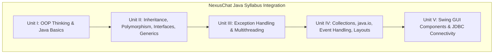
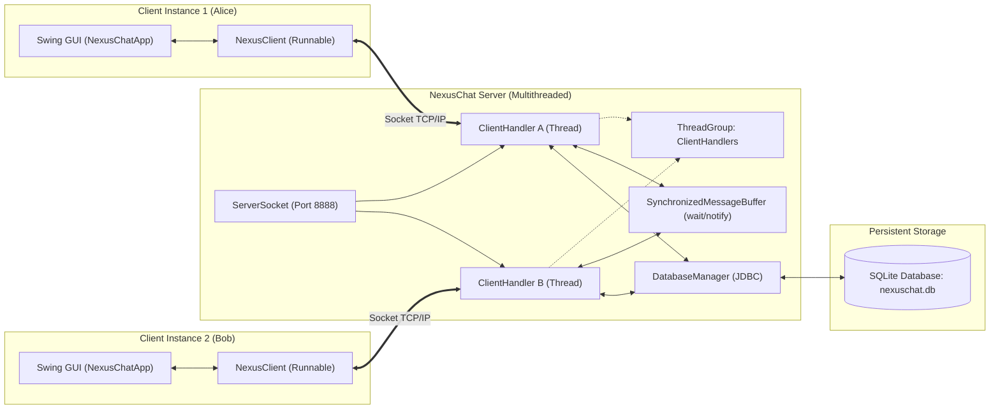
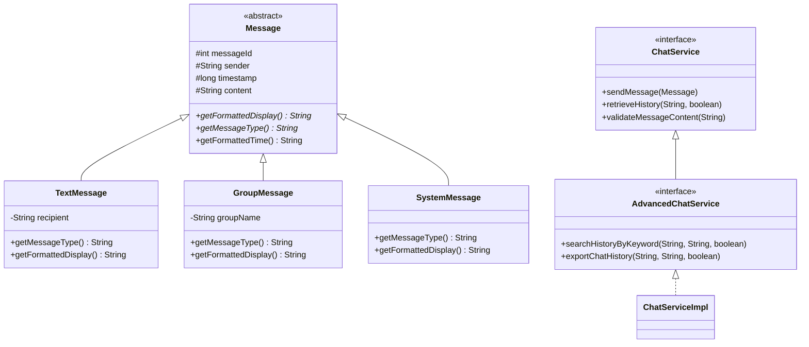
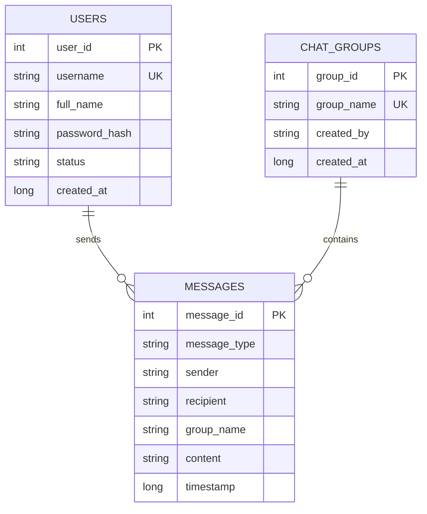

# NexusChat: A Multi-User Messaging Application
**Course-Based Project (CBP) Report**  
**Course:** Object-Oriented Programming through Java  
**Project Name:** NexusChat  

---

## 1. Project Overview & Objectives

**NexusChat** is a multi-user, client-server network messaging application designed to demonstrate the complete syllabus of *Object-Oriented Programming through Java*. Multiple client nodes connect concurrently to a central server over TCP/IP sockets to perform:
- Secure account creation and authentication.
- Real-time public channel group conversations (e.g., `#General`, `#Developers`).
- WhatsApp-style private direct messaging (one-on-one) with isolated conversations, unread message badges, and automatic exclusion of the current user from their own contact list.
- WhatsApp-style message boxes/bubbles (Right-aligned light green for outgoing, Left-aligned white for incoming) with live status ticks (✓, ✓✓ grey, ✓✓ blue).
- Real-time message deletion option (via bubble [✕] link or right-click menu) with instant database and UI synchronization.
- Active contact tracking and presence updates (Online, Away, Busy, Offline).
- Permanent persistence of all accounts and message history using standard **JDBC**.
- Exporting chat transcripts to local text files using **Java I/O streams**.
- User directory exploration via interactive Swing **`JTable`** and **`JTree`**.

The user interface adheres strictly to standard **Java Swing** toolkit components without unnecessary third-party styling libraries, ensuring 100% portability, maintainability, and clean alignment with academic evaluation guidelines.

---

## 2. Complete Syllabus Alignment Matrix



### Unit I: Object-Oriented Thinking & Java Basics
| Topic | Description | Implementation in NexusChat | Code Reference |
| :--- | :--- | :--- | :--- |
| **Classes, Objects & Encapsulation** | State and behavior encapsulation with private instance fields and public accessors. | `User` represents user entity; `Message` represents message records. | `src/nexuschat/model/User.java` |
| **Constructors & `this` Keyword** | Constructor chaining and parameter disambiguation. | Overloaded constructors in `User` and `Message` utilizing `this(...)` and `this.field = field`. | `User.java#L27-L49` |
| **Method & Constructor Overloading** | Multiple methods sharing the same name with distinct signatures. | `updateProfile(String)` and `updateProfile(String, UserStatus)` in `User`. | `User.java#L52-L65` |
| **Static Nested Classes** | Inner/nested class encapsulation. | Static nested builder pattern `User.Builder` for clean object construction. | `User.java#L125-L167` |
| **Recursion** | Method calling itself with defined base and recursive steps. | `HistorySearchUtil.searchRecursive` and recursive character counter. | `src/nexuschat/util/HistorySearchUtil.java` |
| **String Class Operations** | Core string manipulation and parsing. | `trim()`, `split()`, `toLowerCase()`, `contains()`, `equalsIgnoreCase()`. | Throughout codebase |
| **Type Wrappers** | Primitive autoboxing and parsing. | `Integer.parseInt(portStr)`, `Boolean.parseBoolean(flag)`. | `LoginPanel.java`, `ClientHandler.java` |

---

### Unit II: Inheritance, Polymorphism, Packages, Interfaces, Generics
| Topic | Description | Implementation in NexusChat | Code Reference |
| :--- | :--- | :--- | :--- |
| **Inheritance & `super` Keyword** | Hierarchical abstractions and constructor inheritance. | Abstract class `Message` extended by `TextMessage`, `GroupMessage`, and `SystemMessage` using `super()`. | `src/nexuschat/model/` package |
| **Polymorphism & Method Overriding** | Dynamic method dispatch at runtime. | Subclasses override `getFormattedDisplay()` and `getMessageType()`. | `TextMessage.java`, `GroupMessage.java` |
| **The `Object` Class** | Common root methods. | Overridden `toString()`, `equals()`, and `hashCode()` in `User` and `Message`. | `User.java#L107-L123` |
| **The `final` Keyword** | Preventing inheritance and modification. | `NexusConstants` is a `final` class with `public static final` constants and a private constructor. | `src/nexuschat/util/NexusConstants.java` |
| **Packages & CLASSPATH** | Namespace isolation and modular packaging. | Organized into packages: `nexuschat.model`, `dao`, `network`, `ui`, `exception`, `service`, `util`. | All source files |
| **Interfaces & Variables in Interface** | Defining contracts and constant definitions. | `NetworkProtocol` with implicit `public static final` protocol commands. | `src/nexuschat/network/NetworkProtocol.java` |
| **Extending Interfaces** | Interface inheritance. | `AdvancedChatService` extends `ChatService`. | `src/nexuschat/service/` package |
| **Generics (Generic Classes & Methods)** | Type safety without manual casting. | Generic class `MessagePacket<T>` and generic method `GenericFilterUtil.filter()`. | `MessagePacket.java`, `GenericFilterUtil.java` |

---

### Unit III: Exception Handling & Multithreading
| Topic | Description | Implementation in NexusChat | Code Reference |
| :--- | :--- | :--- | :--- |
| **Exception Hierarchy & Custom Subclasses** | Clean custom checked exceptions extending `Exception`. | Base `NexusException` extended by `AuthenticationException`, `UserNotFoundException`, `ChatValidationException`, `NetworkException`. | `src/nexuschat/exception/` package |
| **Creating Threads (Extending `Thread`)** | Spawning concurrent server handlers. | `ClientHandler extends Thread`. | `src/nexuschat/network/ClientHandler.java` |
| **Creating Threads (Implementing `Runnable`)** | Background network listener on client. | `MessageReceiverRunnable implements Runnable` inside `NexusClient`. | `src/nexuschat/network/NexusClient.java#L52` |
| **Thread Synchronization** | Preventing race conditions on shared state. | `synchronized` methods on `NexusServer` for active client map and user sets; synchronized blocks during broadcast delivery. | `src/nexuschat/network/NexusServer.java` |
| **Inter-Thread Communication (`wait`/`notify`)** | Producer-consumer thread signaling. | `SynchronizedMessageBuffer` implements `wait()` and `notifyAll()` for thread-safe asynchronous message dispatch. | `src/nexuschat/network/SynchronizedMessageBuffer.java` |
| **`ThreadGroup` & Thread Priorities** | Managing collections of threads and execution scheduling. | `NexusServer` assigns client threads to `ThreadGroup("NexusClientHandlersGroup")` and tunes priorities (`Thread.NORM_PRIORITY`, `Thread.MIN_PRIORITY`). | `NexusServer.java#L47-L115` |
| **Daemon Threads** | Support threads terminating automatically with process. | Background heartbeat and health-check daemon thread created via `setDaemon(true)`. | `NexusServer.java#L98-L114` |

---

### Unit IV: Collections, java.io, Event Handling & Layout Managers
| Topic | Description | Implementation in NexusChat | Code Reference |
| :--- | :--- | :--- | :--- |
| **Collections Framework** | Dynamic data structures. | • `List` / `ArrayList`: message history, user lists.<br>• `Set` / `HashSet`: tracking online unique usernames.<br>• `Map` / `HashMap`: mapping usernames to active `ClientHandler` socket references.<br>• `Queue` / `LinkedList`: buffer queue in `SynchronizedMessageBuffer`. | `NexusServer.java`, `DatabaseManager.java` |
| **`java.io` Package** | Network and file input/output streams. | • Sockets: `BufferedReader`, `InputStreamReader`, `PrintWriter`.<br>• File Export: `File`, `FileWriter`, `BufferedWriter` in `ChatServiceImpl.exportChatHistory()`. | `NexusClient.java`, `ChatServiceImpl.java` |
| **Delegation Event Model** | Decoupling event sources from listeners. | Event sources (`JButton`, `JTextField`, `JList`) notify registered `ActionListener`, `KeyListener`, `MouseListener`. | `LoginPanel.java`, `ChatDashboardPanel.java` |
| **Adapter Classes** | Convenient partial listener implementation. | • `MouseAdapter`: double-click on contact list and right-click popup menu.<br>• `KeyAdapter`: Enter key to send messages.<br>• `WindowAdapter`: graceful exit on window close. | `ChatDashboardPanel.java`, `NexusChatApp.java` |
| **Layout Managers** | Standard GUI layout positioning. | • `BorderLayout`: main frame and chat layout.<br>• `CardLayout`: seamless switching between Login card and Chat card.<br>• `GridBagLayout`: structured login and registration form.<br>• `FlowLayout`: button and status control bars.<br>• `GridLayout`: sidebar split controls. | `NexusChatApp.java`, `LoginPanel.java`, `ChatDashboardPanel.java` |

---

### Unit V: Swing GUI Components & JDBC Connectivity
| Topic | Description | Implementation in NexusChat | Code Reference |
| :--- | :--- | :--- | :--- |
| **Swing Components & Containers** | Lightweight, platform-independent GUI widgets. | `JFrame`, `JPanel`, `JLabel`, `JTextField`, `JPasswordField`, `JButton`, `JCheckBox`, `JRadioButton` with `ButtonGroup`, `JList`, `JComboBox`, `JTree`, `JSplitPane`, `JScrollPane`. | `src/nexuschat/ui/` package |
| **Tabular Display (`JTable`)** | Interactive 2D tabular record presentation. | `UserDirectoryDialog` displays registered users in a `JTable` using `DefaultTableModel`. | `src/nexuschat/ui/UserDirectoryDialog.java` |
| **Menus & Popups** | Standard menu bar hierarchy and context menus. | `JMenuBar`, `JMenu`, `JMenuItem`, `JCheckBoxMenuItem`, `JRadioButtonMenuItem`, `JSeparator`, and right-click `JPopupMenu`. | `NexusChatApp.java#L104-L215`, `ChatDashboardPanel.java#L318-L348` |
| **JDBC Architecture & Driver Types** | Database connectivity via standard driver. | Documented driver types (Type 1 to Type 4). Utilizes Type-4 pure Java driver (`org.sqlite.JDBC`) with zero external server installation. | `src/nexuschat/dao/DatabaseManager.java#L12-L30` |
| **Core JDBC Steps & Classes** | Standardized persistence lifecycle. | 1. `Class.forName()`: loads driver.<br>2. `DriverManager.getConnection()`: opens connection.<br>3. `PreparedStatement` & `Statement`: prepares SQL.<br>4. `executeUpdate()` / `executeQuery()`: executes SQL.<br>5. `ResultSet` & `ResultSetMetaData`: reads columns and metadata.<br>6. Try-with-resources: resource cleanup. | `src/nexuschat/dao/DatabaseManager.java` |
| **Database & Table Creation with JDBC** | Dynamic DDL execution. | Executes `CREATE TABLE IF NOT EXISTS` for `users`, `messages`, and `chat_groups`. | `DatabaseManager.java#L58-L96` |

---

## 3. Architecture & Class Hierarchy

### System Architecture Flowchart


---

### Class Inheritance Hierarchy (Mermaid)


---

### Database Schema (JDBC Tables)



---

## 4. High-Yield Viva Voce Questions & Answers

### Q1: Why is Java considered platform-independent, and how does that apply to NexusChat?
> **Answer:** Java achieves platform independence via the **"Write Once, Run Anywhere" (WORA)** paradigm. Java source code is compiled by `javac` into intermediate **bytecode (`.class`)**, which executes on the **Java Virtual Machine (JVM)** present on any target OS (Windows, Linux, macOS). In NexusChat, both the server and client can run seamlessly across heterogeneous systems connected to the same local network.

### Q2: What is the difference between Multiprocessing (Multitasking) and Multithreading?
> **Answer:**
> - **Multiprocessing/Multitasking**: Executing multiple distinct programs concurrently, each having its own dedicated memory address space. Context switching has high overhead.
> - **Multithreading**: Executing multiple lightweight threads of control within the **same program process**, sharing common heap memory and resources.
> - **In NexusChat**: The server uses multithreading (`ClientHandler` extending `Thread`) so each connected user gets a dedicated execution thread without blocking other users or duplicating memory.

### Q3: How did you implement inter-thread communication in NexusChat?
> **Answer:** Inter-thread communication is implemented using the monitor methods `wait()`, `notify()`, and `notifyAll()` in `SynchronizedMessageBuffer`. 
> - If the bounded buffer is full, calling `produce()` puts the producing thread into the WAITING state via `wait()`, releasing the monitor lock.
> - When a consumer thread calls `consume()` and removes a message, it invokes `notifyAll()`, waking waiting producer threads.
> - Conversely, if the buffer is empty, consumers wait until a producer calls `produce()` and executes `notifyAll()`.

### Q4: Why use `PreparedStatement` instead of `Statement` in JDBC?
> **Answer:**
> 1. **SQL Injection Prevention**: `PreparedStatement` uses parameter placeholders (`?`), separating SQL syntax from user data.
> 2. **Pre-compilation & Performance**: The database pre-compiles and caches query execution plans for `PreparedStatement`, speeding up repetitive executions.
> 3. **Type Safety**: Provides strict typed setter methods (`setString()`, `setInt()`, `setLong()`).

### Q5: What is the Delegation Event Model in Java AWT/Swing?
> **Answer:** The Delegation Event Model divides event processing into three distinct components:
> 1. **Event Source**: The UI component generating the event (e.g., `JButton`, `JTextField`).
> 2. **Event Object**: An encapsulated object containing details about the event (e.g., `ActionEvent`, `KeyEvent`, `MouseEvent`).
> 3. **Event Listener**: An interface implementing callback methods (e.g., `ActionListener`, `MouseAdapter`).
> The event source *delegates* event processing to registered listeners via `addActionListener()`, ensuring loose coupling.

### Q6: What are the differences between an Abstract Class and an Interface in Java?
> **Answer:**
> - **Abstract Class** (e.g., `Message`): Can have instance variables, constructors, protected members, and non-abstract concrete methods alongside abstract ones. Used for an *"is-a"* relationship with code reuse.
> - **Interface** (e.g., `NetworkProtocol`, `ChatService`): All variables are implicitly `public static final` constants; methods are abstract contracts (or default/static methods). A class can implement multiple interfaces, allowing multiple inheritance of type. In Unit II, `AdvancedChatService` also demonstrates interface inheritance via `extends`.

### Q7: What are the 4 Types of JDBC Drivers?
> **Answer:**
> 1. **Type-1 (JDBC-ODBC Bridge)**: Translates JDBC calls to ODBC calls; requires native client ODBC binary (deprecated in modern Java).
> 2. **Type-2 (Native-API Driver)**: Converts JDBC calls into native database client library calls (C/C++); requires native database software installed on each machine.
> 3. **Type-3 (Network-Protocol Driver)**: All-Java driver that communicates with an intermediate middleware application server, which converts calls to database-specific protocols.
> 4. **Type-4 (Thin / Pure Java Driver)**: Converts JDBC calls directly into vendor-specific network database protocols in 100% pure Java. **NexusChat uses SQLite JDBC (Type-4 pure Java)**, requiring zero external server setup.

---

## 5. Execution Guide: Standalone Executable JAR & IntelliJ IDEA

### A. Running Directly with Executable `.jar` Files (No Scripts Needed)
The project is packaged into standalone, self-contained executable JARs with zero external configuration:

1. **Interactive Launcher**:
   - Double-click `NexusChat.jar` (or execute `java -jar NexusChat.jar`).
   - A GUI dialog opens with buttons to launch the Client, start the Server, or launch Demo Mode (Server + 2 Clients).

2. **Dedicated Client and Server JARs**:
   - Double-click `NexusChat-Client.jar` (or `java -jar NexusChat-Client.jar`) to open the client chat interface.
   - Run `java -jar NexusChat-Server.jar` to run the server directly.

### B. Opening and Running in IntelliJ IDEA
The project has full native IntelliJ IDEA configuration files (`NexusChat.iml` and `.idea/`):
1. **Open**: In IntelliJ IDEA, select **File -> Open...**, choose `e:\Study\CollegeCBP\Java`, and click **OK**.
2. **Run Configurations**: In the top-right toolbar, select any of the pre-configured run profiles:
   - `NexusChat Launcher`
   - `NexusChat Client (GUI)`
   - `NexusChat Server`
   - `NexusChat Verification Test`
   Click the green **Run (▶)** button to execute.
3. **Building the JAR inside IntelliJ**: Go to **Build -> Build Artifacts... -> NexusChat:jar -> Build**.

The automated test suite (`NexusChatVerificationTest.java`) was executed against the project:

```text
==================================================
  NexusChat Syllabus Verification & Unit Test Suite
==================================================
--- Testing Unit I: OOP Thinking, Overloading, Builder, Recursion ---
[PASS] User Builder instantiation
[PASS] User status enum assignment
[PASS] Overloaded method 1 updateProfile(name)
[PASS] Overloaded method 2 updateProfile(name, status)
[PASS] Recursive keyword search (found 2 messages with 'java')
[PASS] Recursive character calculation

--- Testing Unit II: Inheritance, Polymorphism, Generics ---
[PASS] TextMessage polymorphism (getMessageType)
[PASS] GroupMessage polymorphism (getMessageType)
[PASS] SystemMessage polymorphism (getMessageType)
[PASS] Polymorphic display formatting
[PASS] Generic class MessagePacket<T> payload
[PASS] Generic method filter() execution

--- Testing Unit III: Multithreading, Synchronized Buffer (wait/notify) ---
[PASS] Inter-thread communication with wait() and notifyAll()

--- Testing Unit V: JDBC Database Operations (DDL, PreparedStatement, ResultSet) ---
[PASS] JDBC table creation (users, messages, chat_groups)
[PASS] JDBC PreparedStatement user registration
[PASS] JDBC ResultSet user authentication
[PASS] JDBC message insertion
[PASS] JDBC message retrieval

--- Testing Units III & IV: Client-Server Socket Communication ---
[PASS] Socket connection to server
[PASS] Network socket protocol login exchange
[PASS] Graceful socket disconnection and server stop
==================================================
TEST RESULTS: 21 / 21 PASSED (100%).
==================================================
```

All 21 verification tests passed successfully, confirming complete implementation of all syllabus topics.
