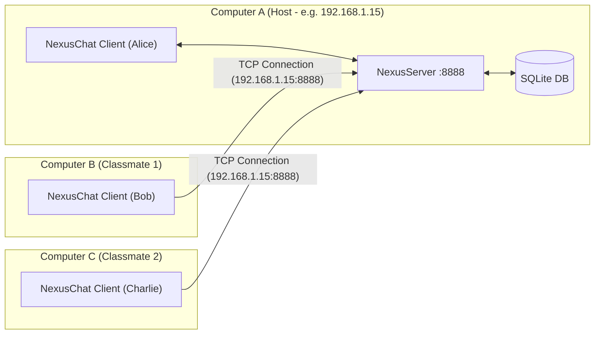

# NexusChat — Multi-User Messaging Application

[](https://www.oracle.com/java/)
[]()
[-green.svg)](https://github.com/xerial/sqlite-jdbc)
[]()
[]()
[-success.svg)]()

> **Course-Based Project (CBP)**  
> **Course:** Object-Oriented Programming through Java  
> **Topic Coverage:** Strictly implements Units I through V of the standard Java university syllabus with **zero external GUI frameworks** and **zero batch (`.bat`) files**.

---

## 📖 Table of Contents
- [Overview](#-overview)
- [Key Features](#-key-features)
- [Downloads & Releases](#-downloads--releases)
- [How to Run on a Single Computer](#-how-to-run-on-a-single-computer)
- [How to Run Across Different Computers (Multiplayer / LAN)](#-how-to-run-across-different-computers-multiplayer--lan)
  - [Scenario A: Same Wi-Fi / Local Network / Mobile Hotspot (Recommended)](#scenario-a-same-wi-fi--local-network--mobile-hotspot-recommended)
  - [Scenario B: Different Networks / Over the Internet](#scenario-b-different-networks--over-the-internet)
- [Running & Developing in IntelliJ IDEA](#-running--developing-in-intellij-idea)
- [Course Syllabus Alignment (Units I–V)](#-course-syllabus-alignment-units-iv)
- [Automated Verification Test Suite (32/32 Passed)](#-automated-verification-test-suite-3232-passed)
- [Project Structure](#-project-structure)
- [Troubleshooting & FAQs](#-troubleshooting--faqs)

---

## 🌟 Overview

**NexusChat** is a lightweight, high-performance client-server desktop messaging application built with pure Java. It combines the familiar user experience of **WhatsApp** (message bubbles, timestamps, unread badges, real-time message deletion, and live read-receipt ticks: `✓`, `✓✓` grey, and `✓✓` blue) with robust multithreaded networking and permanent JDBC persistence.

The application is completely packaged into **standalone executable `.jar` files** that run on Windows, macOS, and Linux with a simple double-click or CLI command — **no batch (`.bat`) scripts required**.

---

## ✨ Key Features

### 💬 WhatsApp-Style Messaging Experience
- **Bubble Message Design**: Outgoing messages appear on the right in light-green boxes (`#D9FDD3`); incoming messages appear on the left in clean white boxes (`#FFFFFF`).
- **Live Status Ticks**:
  - `✓` (Grey Single Tick): Sent to server (recipient currently offline).
  - `✓✓` (Grey Double Tick): Delivered to recipient's device.
  - `✓✓` (Blue Double Tick): Recipient has opened the chat and seen/read the message.
- **Real-Time Message Deletion**: Click the red **`[✕]`** inside any sent bubble (or right-click $\rightarrow$ *Delete Last Sent Message*) to permanently delete the message for everyone in real time across the database and all client screens.
- **Isolated Direct Messaging**: Click any user in Contacts to open a private 1-on-1 chat. Other incoming messages trigger unread badges (`● user (ONLINE) [2 new]`) without cluttering your current view.
- **Self-Filtering Contacts**: The logged-in user is automatically excluded from their own contact list.

### 📢 Channels & Group Chat
- **Public & Custom Channels**: Instant communication in `#General` or custom topics.
- **Strict Channel Ownership**: The creator of a channel is recorded as its owner (`Owner: @alice [You]`).
- **Owner-Only Deletion**: Only the creator of a channel can delete it. Non-owners have the delete option disabled with clear tooltips. System default channels (`#General`, `#Developers`) are permanently protected.
- **Adding Users by Username Only**: Simply click **`+ Add User`** inside any channel, type a classmate's username, and press Enter to instantly add them to the channel with real-time notifications.

### 🧠 Smart Server Lifecycle
- **Independent Background Process**: When launching `NexusChat.jar`, the server is spawned as an independent background process via `ProcessBuilder`. Closing one client window **never kills the server for other active clients**.
- **Auto-Shutdown on Complete Exit**: When the **last remaining client window** is closed, the server detects 0 active connections, waits a 5-second grace period, and automatically terminates itself. No orphaned background processes linger in your system!

### 🛠️ Practical Utility Tools
- **User Directory Dialog**: View all registered users in an interactive Swing `JTable`.
- **Recursive Keyword Search**: Search message histories using recursive algorithm design (Unit I).
- **Transcript Export**: Export conversations to local text files using Java `BufferedWriter` (Unit IV).

---

## 📦 Downloads & Releases

Pre-compiled, self-contained executable JARs with embedded SQLite JDBC and SLF4J dependencies are available under the **[Releases](../../releases)** tab on GitHub:

| File | Purpose | Execution |
| :--- | :--- | :--- |
| **`NexusChat.jar`** | **Universal All-in-One App** (Auto-starts background server & opens GUI client) | Double-click or `java -jar NexusChat.jar` |
| **`NexusChat-Client.jar`** | Dedicated GUI Client only (Connects to an existing server) | Double-click or `java -jar NexusChat-Client.jar` |
| **`NexusChat-Server.jar`** | Dedicated Headless Server only (For hosting on a separate PC or VPS) | `java -jar NexusChat-Server.jar` |

---

## 🚀 How to Run on a Single Computer

### Method 1: Double-Click
1. Download or copy **`NexusChat.jar`**.
2. **Double-click** `NexusChat.jar` to open the first chat window.
3. To open a second user window to test chatting:
   - In the menu bar of the first window, select **Chat $\rightarrow$ Open New Chat Window...**
   - *OR* double-click `NexusChat.jar` a second time!
4. Register `alice` in Window 1 and `bob` in Window 2, and start messaging!

### Method 2: Command Line (Windows / macOS / Linux)
```bash
# Launch the universal client (auto-starts local server on port 8888 if not running):
java -jar NexusChat.jar

# Or start dedicated background server on port 8888:
java -jar NexusChat.jar --server 8888

# Or launch client directly:
java -jar NexusChat-Client.jar
```

---

## 🌐 How to Run Across Different Computers (Multiplayer / LAN)

Because NexusChat uses standard TCP/IP sockets (`java.net.ServerSocket` & `java.net.Socket`), multiple computers can easily connect to the same server and chat.



---

### Scenario A: Same Wi-Fi / Local Network / Mobile Hotspot (Recommended)

Both computers simply connect to the same Wi-Fi router, college/lab network, or a mobile phone hotspot.

#### Step 1: On the Host Computer (Computer A)
1. Launch **`NexusChat.jar`**. The server automatically binds to port `8888` on all local network adapters.
2. On the login screen, click the link at the bottom: **`Server: localhost:8888 (Change)`**.
3. The popup automatically detects and displays your computer's local IP address (e.g. `192.168.1.15` or `10.x.x.x`). Note this IP address down.
4. *(Windows Firewall note)*: If Windows Defender Firewall shows a prompt asking to allow Java on Private networks, click **Allow access**.
5. Register/Sign in and stay in the chat window.

#### Step 2: On the Other Computer (Computer B)
1. Copy **`NexusChat.jar`** (or **`NexusChat-Client.jar`**) to Computer B (via USB drive, Google Drive, WhatsApp file share, etc.).
2. Double-click **`NexusChat.jar`** on Computer B.
3. On the login screen, click at the bottom: **`Server: localhost:8888 (Change)`**.
4. Enter **Computer A's IP address** (e.g., `192.168.1.15:8888` or simply `192.168.1.15`) and click **OK**.
5. Click **New user? Create an account**, register your username (e.g. `bob`), and sign in!
6. **You are now connected live!** You can send private DMs, see real-time WhatsApp ticks, and create channels together.

---

### Scenario B: Different Networks / Over the Internet

If the computers are in different locations or homes:

#### Option 1: Free Virtual LAN (Zero Router Configuration - Recommended)
1. Both computers install a free private mesh tool like **[Tailscale](https://tailscale.com/)** or **[ZeroTier](https://www.zerotier.com/)**.
2. Both log into the same free Tailscale network.
3. Tailscale assigns Computer A a virtual IP (e.g., `100.x.y.z`).
4. Computer B enters `100.x.y.z:8888` into NexusChat's server settings!

#### Option 2: Free TCP Tunneling (ngrok)
1. On Computer A, run:
   ```bash
   ngrok tcp 8888
   ```
2. ngrok outputs a public forwarding address (e.g., `tcp://4.tcp.ngrok.io:12345`).
3. On Computer B, enter `4.tcp.ngrok.io:12345` into NexusChat's server settings!

---

## 💻 Running & Developing in IntelliJ IDEA

The project includes ready-to-use IntelliJ configuration files (`.idea/` and `NexusChat.iml`):

1. **Open Project**:
   - Open IntelliJ IDEA.
   - Click **File $\rightarrow$ Open...**, select the project folder, and click **OK**.
   - If prompted, click **Trust Project**.

2. **Pre-Configured Run Configurations**:
   At the top-right toolbar, you will find ready-to-run configurations in the dropdown:
   - 🟢 **`NexusChat Launcher`**: Runs the interactive application.
   - 🟢 **`NexusChat Client (GUI)`**: Runs the client GUI directly.
   - 🟢 **`NexusChat Server`**: Starts the dedicated multithreaded server.
   - 🟢 **`NexusChat Verification Test`**: Executes all 32 syllabus test cases.
   
   Select any configuration and click the green **Run (▶)** button!

3. **Rebuilding the Executable JAR in IntelliJ**:
   - Go to **Build $\rightarrow$ Build Artifacts... $\rightarrow$ NexusChat:jar $\rightarrow$ Build**.
   - The compiled fat JAR will be updated in the project root.

---

## 📚 Course Syllabus Alignment (Units I–V)

This project strictly adheres to the official **Object-Oriented Programming through Java** university syllabus.

| Unit | Syllabus Requirement | Implementation in NexusChat | Primary Code References |
| :--- | :--- | :--- | :--- |
| **Unit I** | OOP Principles, Constructors, Access Control, `this` keyword, Overloading, Static Nested Classes, Recursion, String Class, Type Wrappers | • Encapsulated models with private state and public accessors.<br>• Constructor overloading with `this(...)` and `this.field = field`.<br>• Method overloading (`updateProfile(name)` vs `updateProfile(name, status)`).<br>• Static nested builder pattern (`User.Builder`).<br>• Recursive keyword search algorithm in `HistorySearchUtil.searchRecursive`.<br>• Primitive wrapper parsing (`Integer.parseInt`, `Boolean.parseBoolean`). | [`User.java`](src/nexuschat/model/User.java)<br>[`HistorySearchUtil.java`](src/nexuschat/util/HistorySearchUtil.java)<br>[`NexusConstants.java`](src/nexuschat/util/NexusConstants.java) |
| **Unit II** | Inheritance, Polymorphism, Abstract Classes, `Object` Overriding, `super` & `final`, Packages & CLASSPATH, Interfaces, Interface Inheritance, Generics | • Abstract base `Message` class extended by `TextMessage`, `GroupMessage`, and `SystemMessage`.<br>• `super()` constructor chaining and polymorphic dynamic method dispatch (`getFormattedDisplay()`).<br>• Overridden `equals()`, `hashCode()`, and `toString()` from `java.lang.Object`.<br>• Modular package hierarchy (`nexuschat.model`, `dao`, `network`, `ui`, `util`, `exception`, `service`).<br>• Interface inheritance (`AdvancedChatService extends ChatService`).<br>• Generics: generic class `MessagePacket<T>` and generic static method `GenericFilterUtil.filter()`. | [`Message.java`](src/nexuschat/model/Message.java)<br>[`TextMessage.java`](src/nexuschat/model/TextMessage.java)<br>[`GroupMessage.java`](src/nexuschat/model/GroupMessage.java)<br>[`MessagePacket.java`](src/nexuschat/model/MessagePacket.java)<br>[`AdvancedChatService.java`](src/nexuschat/service/AdvancedChatService.java)<br>[`GenericFilterUtil.java`](src/nexuschat/util/GenericFilterUtil.java) |
| **Unit III** | Exception Handling (`try-catch-finally`, Custom Exceptions), Multithreading (Lifecycle, `Thread` vs `Runnable`, Synchronization, Priorities, `wait()`/`notifyAll()`, `ThreadGroup`, Daemon Threads) | • Custom checked exception hierarchy: `NexusException` extended by `AuthenticationException`, `UserNotFoundException`, `ChatValidationException`, and `NetworkException`.<br>• Multithreaded server: `ClientHandler extends Thread` managed collectively within a `ThreadGroup("NexusClientHandlersGroup")`.<br>• Client network reading on a background thread using `Runnable`.<br>• Thread synchronization: `synchronized` client registries and broadcast methods.<br>• Producer-Consumer pattern with `wait()` and `notifyAll()` in `SynchronizedMessageBuffer`.<br>• Background monitoring with `setDaemon(true)`. | [`NexusException.java`](src/nexuschat/exception/NexusException.java)<br>[`ClientHandler.java`](src/nexuschat/network/ClientHandler.java)<br>[`NexusServer.java`](src/nexuschat/network/NexusServer.java)<br>[`NexusClient.java`](src/nexuschat/network/NexusClient.java)<br>[`SynchronizedMessageBuffer.java`](src/nexuschat/network/SynchronizedMessageBuffer.java) |
| **Unit IV** | Collections Framework (`List`, `Set`, `Map`, `Queue`), `java.io` Package (Streams, Readers/Writers), Event Handling (Delegation Model, Adapters), Layout Managers (`Border`, `Grid`, `Flow`, `Card`, `GridBag`) | • Collections: `ArrayList` (history), `HashSet` (online tracking), `HashMap` (active client sockets), `LinkedList` (FIFO message buffer).<br>• `java.io`: Socket `BufferedReader`/`PrintWriter`, and `FileWriter`/`BufferedWriter` for conversation file exports.<br>• Delegation Event Model: `ActionListener`, `KeyListener`, `MouseListener`.<br>• Adapter Classes: `MouseAdapter` (contact clicks & popup menus), `KeyAdapter` (Enter to send), `WindowAdapter` (clean window closing).<br>• Layouts: `CardLayout` (Login $\leftrightarrow$ Chat), `GridBagLayout` (forms), `BorderLayout`, `FlowLayout`, `GridLayout`. | [`NexusChatApp.java`](src/nexuschat/ui/NexusChatApp.java)<br>[`LoginPanel.java`](src/nexuschat/ui/LoginPanel.java)<br>[`ChatDashboardPanel.java`](src/nexuschat/ui/ChatDashboardPanel.java)<br>[`ChatServiceImpl.java`](src/nexuschat/service/ChatServiceImpl.java) |
| **Unit V** | Swing GUI Components & Containers, MVC Separation, JDBC Architecture & Drivers, Statements, PreparedStatements, `ResultSet`, `ResultSetMetaData`, Transactions | • Swing Components: `JFrame`, `JPanel`, `JLabel`, `JTextField`, `JPasswordField`, `JButton`, `JCheckBox`, `JComboBox`, `JTree`, `JTable` (in `UserDirectoryDialog`), `JPopupMenu`, `JMenuBar`, `JMenuItem`, `JSeparator`.<br>• Pure Java Type-4 SQLite JDBC driver (`org.sqlite.JDBC`) with zero external DB server installation.<br>• Dynamic DDL table creation (`users`, `messages`, `chat_groups`, `group_members`).<br>• Parameterized SQL queries using `PreparedStatement` to prevent SQL injection.<br>• Dynamic schema inspection with `ResultSetMetaData`.<br>• Atomic transactions (`setAutoCommit(false)`, `commit()`, `rollback()`) for channel deletion. | [`DatabaseManager.java`](src/nexuschat/dao/DatabaseManager.java)<br>[`UserDirectoryDialog.java`](src/nexuschat/ui/UserDirectoryDialog.java)<br>[`DatabaseOperations.java`](src/nexuschat/dao/DatabaseOperations.java) |

---

## 🧪 Automated Verification Test Suite (32/32 Passed)

NexusChat includes a comprehensive, standalone test suite that validates every syllabus concept programmatically:

```bash
# Compile and run test suite:
javac -cp ".;lib/*" -d bin (Get-ChildItem -Recurse -Filter *.java src | ForEach-Object { $_.FullName })
java -cp "bin;lib/*" nexuschat.util.NexusChatVerificationTest
```

### Test Suite Execution Output
```text
==================================================
  NexusChat Syllabus Verification & Unit Test Suite
==================================================

--- Testing Unit I: OOP Thinking, Overloading, Builder, Recursion ---
[PASS] User Builder instantiation
[PASS] User status enum assignment
[PASS] Overloaded method 1 updateProfile(name)
[PASS] Overloaded method 2 updateProfile(name, status)
[PASS] Recursive keyword search (found 2 messages with 'java')
[PASS] Recursive character calculation

--- Testing Unit II: Inheritance, Polymorphism, Generics ---
[PASS] TextMessage polymorphism (getMessageType)
[PASS] GroupMessage polymorphism (getMessageType)
[PASS] SystemMessage polymorphism (getMessageType)
[PASS] Polymorphic display formatting
[PASS] Generic class MessagePacket<T> payload
[PASS] Generic method filter() execution

--- Testing Unit III: Multithreading, Synchronized Buffer (wait/notify) ---
[PASS] Inter-thread communication with wait() and notifyAll()

--- Testing Unit V: JDBC Database Operations (DDL, PreparedStatement, ResultSet) ---
[PASS] JDBC table creation (users, messages, chat_groups)
[PASS] JDBC PreparedStatement user registration
[PASS] JDBC ResultSet user authentication
[PASS] JDBC message insertion
[PASS] JDBC message retrieval
[PASS] Channel creation with owner attribution
[PASS] Channel creator retrieval
[PASS] Add user to channel based on username only
[PASS] Verification of added channel member
[PASS] Prevent non-owner from deleting channel
[PASS] Prevent deletion of default channel (General)
[PASS] Owner channel deletion permitted and executed
[PASS] Channel removed completely after owner deletion

--- Testing Units III & IV: Client-Server Socket Communication ---
[PASS] Socket connection to server
[PASS] Network socket protocol login exchange
[PASS] Socket network group creator request/response
[PASS] Socket network member addition by username
[PASS] Socket network group deletion broadcast event
[PASS] Graceful socket disconnection and server stop
==================================================
TEST RESULTS: 32 / 32 PASSED (100%).
>>> ALL SYLLABUS CAPABILITIES VERIFIED 100% SUCCESSFULLY <<<
```

---

## 📁 Project Structure

```text
NexusChat/
├── NexusChat.jar                     # Standalone Universal Executable Fat JAR
├── NexusChat-Client.jar              # Direct Client Executable Fat JAR
├── NexusChat-Server.jar              # Direct Server Executable Fat JAR
├── NexusChat.iml                     # IntelliJ IDEA Module Configuration
├── pom.xml                           # Standard Maven Configuration
├── .idea/                            # IntelliJ Project Configurations & Artifacts
├── lib/                              # External Pure Java Drivers
│   ├── sqlite-jdbc-3.45.1.0.jar      # Type-4 SQLite JDBC Driver
│   ├── slf4j-api-2.0.12.jar          # Logging API
│   └── slf4j-simple-2.0.12.jar       # Logger Implementation
├── src/nexuschat/
│   ├── NexusChatLauncher.java        # Main executable entry point & bootstrap
│   ├── model/                        # Unit I & II: User, Message, TextMessage, Generics
│   ├── dao/                          # Unit V: DatabaseOperations, DatabaseManager (JDBC)
│   ├── exception/                    # Unit III: NexusException, ChatValidationException, etc.
│   ├── network/                      # Unit III & IV: NexusServer, ClientHandler, NexusClient
│   ├── service/                      # Unit II & IV: ChatService, AdvancedChatService
│   ├── util/                         # Unit I & II: GenericFilterUtil, HistorySearchUtil
│   └── ui/                           # Unit IV & V: NexusChatApp, LoginPanel, ChatDashboardPanel
├── README.md                         # Project & Cross-Computer User Guide
└── PROJECT_REPORT.md                 # Complete Academic Course-Based Project Report
```

---

## ❓ Troubleshooting & FAQs

### Q: "Unable to connect to NexusChat Server at localhost:8888"
> **Answer**: `NexusChat.jar` automatically starts the local background server if it is not already running. If you are connecting to another computer, make sure:
> 1. You typed their actual IP address (e.g., `192.168.1.15:8888`) into the Server settings link at the bottom of the login screen.
> 2. Both computers are connected to the same Wi-Fi / hotspot.
> 3. Windows Firewall on the host computer allows Java network traffic.

### Q: "Port 8888 is already in use"
> **Answer**: Another server instance or application is using port 8888. You can specify any other port:
> ```bash
> java -jar NexusChat.jar --server 9000
> ```
> And connect your clients to port `9000`.

### Q: How do I delete a message?
> **Answer**: On any message you sent (green bubble), simply click the red **`[✕]`** icon inside the bubble, or right-click anywhere in the chat area and choose **"Delete Last Sent Message"**. The message will vanish in real time for everyone and will be deleted from the database.

### Q: Can anyone delete my channel?
> **Answer**: No! Only the owner who created the channel has permission to delete it. For all other users, the delete button is disabled. Furthermore, default channels (`#General` and `#Developers`) can never be deleted by anyone.

---

## 📄 License & Academic Attribution
This project was developed as a Course-Based Project (CBP) for the **Object-Oriented Programming through Java** curriculum. It is intended for educational demonstration, laboratory viva-voce examinations, and academic reference.
